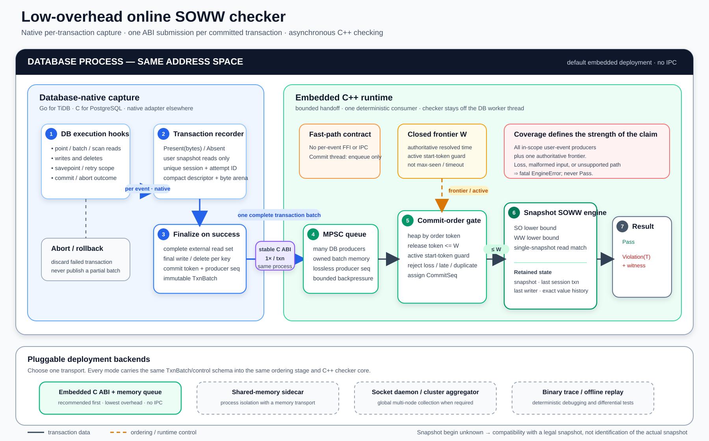

# Online Consistency Engine Implementation Plan

Status: V1 checker semantics frozen; serialized global-lock baseline planned

Initial checker: snapshot compatibility using session order and write-write
order (`SnapshotSOWWChecker`)

## 1. Objective

Build an online engine that consumes committed transactions while a database is
running and reports whether each closed commit-order prefix remains compatible
with the selected isolation model.

The first implementation will support the existing SOWW snapshot checker. The
architecture must allow additional isolation checkers and database adapters
without duplicating the checker algorithm in every database language.

The default deployment is an embedded asynchronous C++ runtime:



The existing diagram illustrates the `frontier-reorder` alternative. The first
release baseline instead follows the serialized finalization and direct FIFO path
in Section 9.1; the diagram must be revised before implementation begins.

The primary performance objective is to keep database worker threads out of the
checker algorithm. Database-native code records events locally, publishes one
complete batch after a successful write commit or read-only completion, and
returns after transferring ownership into a bounded queue.

## 2. Agreed Design Decisions

1. Maintain one C++ implementation of each consistency algorithm.
2. Keep event capture database-specific and written in the database's native
   language.
3. Run the orderer and checker asynchronously from database worker threads.
4. Submit one complete transaction batch after a successful write commit or
   read-only/no-write completion; do not call across a language boundary for
   every event.
5. Use an embedded runtime and in-memory queue by default. Shared-memory,
   socket, and offline transports may be added behind the same batch contract.
6. Use vector-backed transaction storage for C and C++ databases.
7. Use C++-owned, stable, chunked arenas when the producer language cannot
   safely transfer ownership of movable or garbage-collected memory, initially
   TiDB/Go.
8. Expose storage through a common immutable transaction-view/range API.
9. Assign checker-local `CommitSeq` values only after the selected ordering
   protocol proves the corresponding database order is closed. The initial
   baseline uses serialized publication; the frontier/reorder protocol remains
   a separate alternative.
10. Bound capture, queue, and reorder memory by bytes, not transaction count.
11. Select chunk size classes from measured packed transaction-size
    distributions. Do not hard-code a size based only on average event counts.
12. The database is empty at the beginning of each checked run.
13. The checker compares values, not MVCC version or writer identities.
14. Read results are explicitly tagged as `Present(bytes)` or `Absent`.
15. A transaction with two snapshot reads of the same key returning different
    tagged results is a violation.
16. A new globally unique session ID is assigned when a session is created, and
    SO is the transaction order within that session.
17. A write transaction uses its authoritative final commit timestamp. In the
    serialized global-lock baseline, a read-only TiDB transaction obtains a new
    global TSO timestamp after all reads complete and uses that completion
    timestamp as its commit-order token. The frontier/reorder alternative may
    retain its existing `start_ts` token and active-start protocol.
18. The consistency result has only `Pass` and `Violation(T)`. Invalid,
    incomplete, lost, or ambiguously ordered input is a fatal runtime/protocol
    error; the engine stops and must not emit `Pass` for that prefix.
19. Pipeline mode (`capture-only`, `order-only`, or `full`) and ordering protocol
    (`serialized-global-lock` or `frontier-reorder`) are independent
    configuration dimensions.
20. The serialized global-lock protocol is the first implementation and
    performance baseline. Transaction execution and prewrite remain concurrent;
    only final commit/completion ordering and lossless publication are
    serialized.

## 3. Scope and Non-goals

### Initial scope

- Successfully committed write transactions and successfully completed
  read-only/no-write application transactions.
- The in-scope population is fixed when the session adapter creates a logical
  transaction identity and `session_seq` for an ordinary transactional statement
  or explicit transaction. Every such logical transaction that completes
  successfully produces exactly one batch, including a fully lazy transaction
  that never activates a KV transaction and a transaction whose writes normalize
  to no effective mutation. SQL control statements for which no logical
  transaction is created remain outside the population.
- An empty initial database.
- Point reads with explicit value or miss.
- Final writes with explicit value or delete.
- Snapshot/external reads distinguished from local/read-own-write reads.
- Globally unique session IDs and explicit in-session transaction order.
- A unique, authoritative commit-order token.
- A protocol-defined read-only commit-order token: a fresh post-read completion
  TSO in the serialized global-lock baseline, or the registered `start_ts` in
  the frontier/reorder alternative.
- Value-level consistency rather than version-level read-from checking.
- Only user-session transactions and the events attributed to them. Internal
  background transactions and their events are outside the model.
- Iterator and scan output interpreted as the point reads currently emitted by
  the offline trace; predicate completeness and phantom absence are not checked.
- Single-process embedded deployment first.
- Post-commit detection rather than transaction enforcement.
- Lossless capture. A capture or ordering failure terminates the checked run.

### Deferred scope

- Preventing a transaction from committing.
- Predicate and range-read validation beyond the returned point reads.
- Cluster-wide TiDB claims until all producers and a global frontier are
  integrated.
- Partial commit orders without an authoritative total-order refinement.
- MVCC version/writer identity and precise read-from checking.
- Internal database transaction behavior.
- Production high availability and transparent recovery before the local
  implementation is correct and measured.

## 4. Frozen V1 Semantics

The online engine follows the problem setting of the existing offline SOWW
algorithm. Let committed transactions be ordered by the supplied commit-order
token. For each transaction `T`, the checker asks whether there exists one
earlier commit-prefix snapshot that:

1. Is no older than `T`'s previous transaction in the same session.
2. Is no older than the latest earlier committed writer of any key in `T`'s
   final write set.
3. Matches every snapshot-source point read in `T` by key and tagged value.

The checker algorithm does not use a transaction's `start_ts` as a snapshot
bound. This is an existential commit-prefix compatibility problem by
definition; it does not try to reconstruct the actual hidden snapshot or
read-from version. An ordering protocol may use `start_ts` only as an ordering
token or guard where explicitly stated below.

The remaining semantic contract is fixed as follows:

- The initial snapshot is empty.
- Every successfully completed in-scope logical transaction, including the first
  read-only transaction in a session and an in-scope empty/no-KV transaction, is
  checked.
- Read results are `Present(bytes)` or `Absent`. `Present(empty)` is distinct
  from `Absent`; delete writes use `Absent` in the write context.
- An event missing its required tag or payload is invalid input and terminates
  the checked run.
- All snapshot reads in one transaction must match a single candidate prefix.
- If repeated snapshot reads of the same key return different tagged results,
  report `Violation(T)` immediately for that transaction.
- Local/read-own-write probes are removed before SOWW checking, matching the
  existing offline preprocessing. They may be validated by a separate checker
  later.
- Each session receives a globally unique `SessionUid` when it is created.
  V1 represents it as `{runtime_epoch, producer_id, local_session_counter}`.
  `runtime_epoch` is a fresh 128-bit runtime identity and `producer_id` is unique
  within it, so process restart cannot reuse a session identity.
  `session_seq` is assigned when the logical transaction is created, is strictly
  increasing within that session, and defines SO. A physical retry retains the
  same `session_seq` and receives a new `TransactionAttemptUid`.
- `EventSeq` is strictly increasing within a transaction. Among committed
  transactions in one session, both `session_seq` and the supplied order token
  must increase; duplicate or decreasing values are fatal adapter/order errors.
- A write transaction uses its authoritative final commit timestamp in every
  ordering protocol. In the serialized global-lock baseline, a read-only TiDB
  transaction obtains a fresh global TSO timestamp after all reads finish and
  uses it as a completion/commit-order token. In the frontier/reorder
  alternative, a read-only transaction may use its registered `start_ts` under
  the active-start protocol in Section 9. Neither choice becomes a snapshot
  upper bound or another SOWW constraint.
- Commit-order tokens must be unique for V1. A duplicate or out-of-order token
  is a fatal protocol error, not a consistency result.
- `TransactionUid` names a user-visible logical transaction. Physical retries
  use distinct `TransactionAttemptUid`s. Exactly one attempt may commit and
  contribute reads/writes; failed attempts and rolled-back mutations do not
  update state.
- Reads preserved after a savepoint follow the user-visible transaction trace.
  Internal/speculative probes are excluded by the adapter.
- Only user-session transactions and their attributed KV events are modeled.
  Internal/background transactions are ignored by definition. The run starts
  after schema setup and before user data loading, so "empty" means the modeled
  user keyspace is empty; database metadata need not be physically absent.
- Equality is exact byte equality. Equal-valued versions are intentionally
  indistinguishable.
- A scan contributes the returned point-read events only. The checker does not
  model predicates, omitted keys, or phantom absence.
- `Pass` means that the complete ordered prefix processed so far satisfies the
  SOWW algorithm. `Violation(T)` means transaction `T` has no valid candidate
  snapshot or has inconsistent repeated reads.
- Capture loss, unsupported input, memory exhaustion without backpressure,
  ordering ambiguity, and decoder corruption are `EngineError`s. The runtime
  stops; they never become `Pass` or a third consistency verdict.

Semantic corrections required to make the current implementation match this
contract—especially empty initial state, first read-only checking, tagged
results, and unconditional repeated-read detection—must receive focused tests.

## 5. Normalized Transaction Model

The checker-facing model is independent of database storage and transport:

```cpp
using CommitSeq = std::uint64_t;
using PublicationSeq = std::uint64_t;
inline constexpr PublicationSeq kUnassignedPublicationSeq = 0;

enum class OrderTokenKind : std::uint8_t {
  WriteCommit,
  ReadOnlyStart,
  ReadOnlyCompletion,
  NoWriteCompletion,
};

struct CommitOrderToken {
  ClusterEpoch epoch;
  std::uint64_t timestamp;
  std::optional<std::uint64_t> authoritative_tie_breaker;
};

struct OrderedTxnMeta {
  CommitSeq commit_seq;
  TransactionUid transaction_id;
  TransactionAttemptUid attempt_id;
  SessionUid session_id;
  std::uint64_t session_seq;
  CommitOrderToken commit_token;
  OrderTokenKind order_token_kind;
  PublicationSeq publication_seq;
  ProducerId producer_id;
  ProducerSeq producer_seq;
};

enum class ValueState : std::uint8_t {
  Present,
  Absent,
};

enum class ReadSource : std::uint8_t {
  Snapshot,
  Local,
};

struct ReadView {
  EventSeq sequence;
  ByteView key;
  ValueState state;
  ByteView value;
  ReadSource source;
};

struct WriteView {
  EventSeq sequence;
  ByteView key;
  ValueState state;
  ByteView value;
};
```

`order_token_kind` and `publication_seq` are ordering/transport evidence and do
not add checker constraints. `serialized-global-lock` requires a nonzero,
contiguous `publication_seq` and accepts `WriteCommit`, `ReadOnlyCompletion`, or
`NoWriteCompletion`.
`frontier-reorder` leaves publication sequence at
`kUnassignedPublicationSeq`, uses `producer_seq` plus its frontier state, and
represents its start-token read-only path as `ReadOnlyStart`. The producer
leaves `commit_seq` unassigned in both protocols.

`ByteView` is borrowed and immutable. The owning batch must remain alive until
the checker returns. The checker may not retain a `ByteView`; persistent state
and diagnostics must intern or copy the necessary bytes first.

The runtime allocates `SessionUid` at session creation. The adapter assigns
`session_seq` per logical transaction and `EventSeq` per event. Those counters
are the complete SO representation; thread scheduling, queue arrival order, and
wall-clock time do not define SO.

The initial event stream may contain every write. During a single forward pass,
the checker keeps the last write for each key, producing the final write set
without requiring reverse or random-access iteration.

### 5.1 Compact tagged batch format

Use one versioned, pointer-free wire layout for both vector and chunk storage.
The checker sees the same descriptors from either backend; only ownership and
segment storage differ. V1 uses a 32-byte fixed-width descriptor:

```cpp
enum class PackedEventOp : std::uint8_t {
  Invalid = 0,
  Read = 1,
  Write = 2,
};

enum class PackedValueState : std::uint8_t {
  Invalid = 0,
  Present = 1,
  Absent = 2,
};

inline constexpr std::uint16_t kNullSegment = 0xffff;

struct BlobRefV1 {
  std::uint32_t offset_le;
  std::uint32_t size_le;
  std::uint16_t segment_le;
  std::uint16_t reserved_le;
};

struct alignas(8) EventDescriptorV1 {
  std::uint32_t sequence_le;
  std::uint8_t op;
  std::uint8_t value_state;
  std::uint8_t flags;
  std::uint8_t reserved;
  BlobRefV1 key;
  BlobRefV1 value;
};

static_assert(sizeof(BlobRefV1) == 12);
static_assert(sizeof(EventDescriptorV1) == 32);
static_assert(offsetof(EventDescriptorV1, key) == 8);
static_assert(offsetof(EventDescriptorV1, value) == 20);
```

Transaction, session, attempt, producer, and commit-order metadata live once in
the batch header, not in every descriptor. Descriptors are contiguous and
aligned to 32 or 64 bytes, so two fit in one cache line. Key and value payloads
are stored densely without per-value padding. The vector backend uses segment
zero; the chunk backend uses a segment table and never flattens payloads.

The canonical null reference is `{offset=0, size=0,
segment=kNullSegment, reserved=0}`. The tag, not byte length, defines meaning:

| Operation | Value state | Meaning |
|---|---|---|
| Read | `Present` | Returned bytes; a null reference means present empty bytes |
| Read | `Absent` | Read miss; value reference must be null |
| Write | `Present` | Final written bytes; null means an empty value |
| Write | `Absent` | Delete; value reference must be null |

Both packed tags reserve zero for `Invalid`, so a zeroed or partially filled
record is rejected rather than interpreted as a valid empty result. V1 is
little-endian and has a batch header containing magic, version, descriptor size,
feature bits, event/read/write counts, and segment counts. It contains no raw
pointers, `size_t`, `bool`, compiler bitfields, optional values, or
language-runtime objects.
It also omits producer-computed hashes: the checker hashes exact key bytes so
the hash implementation can change without changing the cross-language format.

Producer APIs are tagged even though the stored form is compact:

```cpp
struct PresentBytes {
  std::span<const std::byte> bytes;
};
struct Absent {};
using TaggedBytes = std::variant<PresentBytes, Absent>;

Status appendRead(EventSeq sequence, ByteView key, TaggedBytes result);
Status appendWrite(EventSeq sequence, ByteView key, TaggedBytes result);
```

The Go adapter exposes equivalent `AppendPresentRead`, `AppendAbsentRead`,
`AppendPresentWrite`, and `AppendDelete` methods. Builders write payload
references first and publish the nonzero operation/state tags last, then seal
and validate the whole batch. This makes incomplete records reliably invalid
without storing a `std::variant` or Go interface in the packed representation.

The recorder classifies local/read-own-write events but removes them before
sealing the normalized SOWW batch. Consequently V1 descriptor flags are zero;
future event-source semantics require a new declared feature rather than a
silent reinterpretation.

Before publication to checker state, scalar reference validation checks:

- Header/version/feature support and zero reserved fields.
- Exact descriptor and read/write counts.
- Strictly increasing event sequence numbers.
- Nonzero, supported operation and value tags.
- Canonical empty/null references and all segment bounds using widened
  `offset + size` arithmetic.

Only a fully validated batch becomes a `ValidatedTxnView`; validation completes
before any checker state mutation. ISA-specific validation may process several
fixed descriptors at once, but must be differential-tested against the scalar
decoder. Runtime dispatch selects scalar, SSE2/AVX2, or AArch64 NEON once per
engine, never through an indirect call per event. Optimized `memcmp` remains the
exact comparator for variable-sized keys and values unless profiling proves a
custom SIMD comparator is better.

Compact descriptors primarily improve cache locality. The strongest initial
SIMD opportunity is the control-byte array of the repeated-read table described
in Section 7; variable-length payload references do not make the whole checker
loop automatically vectorizable.

## 6. Storage-neutral Transaction Traversal

Use C++20 concepts and ranges rather than a heap-allocated virtual iterator. A
virtual `next()` would add dynamic dispatch to every event in the large TPCC
traces.

```cpp
template <typename T>
concept TransactionView = requires(const T &txn) {
  { txn.meta() } -> std::same_as<const OrderedTxnMeta &>;
  { txn.events() } -> std::ranges::input_range;
};

class SnapshotSOWWEngine {
public:
  ConsumeResult consume(const TraceTxnView &txn);
  ConsumeResult consume(const VectorTxnView &txn);
  ConsumeResult consume(const ChunkTxnView &txn);

private:
  template <TransactionView T>
  ConsumeResult consumeImpl(const T &txn);
};
```

If one runtime container must hold multiple storage types, use one
`std::variant` visit per transaction:

```cpp
using RuntimeTxnView = std::variant<VectorTxnView, ChunkTxnView>;

return std::visit(
    [&](const auto &view) { return engine.consume(view); },
    runtime_view);
```

The event loop remains statically dispatched. If a future plugin boundary
requires type erasure, erase at transaction or segment granularity rather than
once per event.

### 6.1 Vector backend

Target: databases implemented in C or C++.

- Build a heap-stable `VectorBatch` owned by `std::unique_ptr`.
- Allow its vectors to reserve and grow during capture.
- Store offsets rather than pointers while a blob vector can reallocate.
- Seal the batch before publication.
- Publish the owning pointer; never copy the vectors into the queue.
- Treat mutation after publication as an invariant violation.
- Construct borrowed event views only after the batch is sealed.

### 6.2 Chunked arena backend

Target: TiDB/Go and other producers with cross-runtime ownership constraints.

- C++ allocates chunks from a bounded native pool.
- Go writes raw pointer-free records directly into the returned spans.
- Native memory contains bytes, integers, offsets, and native handles only; it
  never contains Go strings, slices, maps, interfaces, or Go pointers.
- A key or value blob is contiguous within one segment; co-locate an event's
  blobs when practical. An oversized blob receives a dedicated segment, and no
  descriptor crosses a descriptor-span boundary.
- Savepoints retain a `(chunk, offset, sequence)` checkpoint. Rollback truncates
  the chain to that checkpoint without repacking.
- Successful submission transfers the opaque batch handle to C++.
- Failed submission leaves ownership with the adapter.
- Abort explicitly returns the batch to the pool.

The expected ownership state machine is:

```text
Free → Capturing (producer) → Published (C++)
     → Pending order → Checking → Free
```

### 6.3 Offline trace backend

`TraceTxnView` adapts the existing `Trace` and `Transaction` without copying the
whole transaction. It resolves existing `EventId` references as it traverses.
The offline `SnapshotSOWWChecker::run()` assigns dense `CommitSeq` values in the
already validated trace order and feeds the same streaming engine.

## 7. Stateful SOWW Engine

Extract the algorithm from `SnapshotSOWWChecker::run()` into a stateful,
single-consumer object:

```cpp
class SnapshotSOWWEngine {
public:
  explicit SnapshotSOWWEngine(SnapshotSOWWOptions options = {});

  ConsumeResult consume(const RuntimeTxnView &txn);
  void reset();

private:
  CommitSeq next_expected_seq_ = 0;
  SnapshotState current_snapshot_ = SnapshotState::empty();
  SessionLastTxnMap latest_by_session_;
  KeyLastWriterMap latest_writer_by_key_;
  HistoryLog history_;
  KeyInterner keys_;
  ValueInterner values_;
};
```

The engine must enforce:

```text
txn.commit_seq == next_expected_seq
```

Replace trace-dependent history such as `DeltaEntry{EventId, old_value}` with
self-contained state:

```cpp
struct DeltaEntry {
  KeyId key;
  std::optional<ValueId> old_value;
};

struct HistoryEntry {
  CommitSeq commit_seq;
  std::vector<DeltaEntry> delta;
};
```

Reads remain borrowed during `consume()`. Keys and values entering the current
snapshot or rollback history are interned exactly. Hashes accelerate lookup,
but collisions require full byte comparison.

Repeated reads are handled while collecting the unique read set, not in a
second pass. Use a transaction-local insert-only flat table with a separate
control-byte array and slots containing `{full_hash, first_event_handle}`:

```text
control: [h2 h2 empty h2 ...]  // one byte per slot
slots:   [ReadSlot ...]
```

For each snapshot read, hash the key once and probe one 16- or 32-byte control
group at a time. A matching seven-bit fingerprint is only a candidate; equality
requires matching the full hash, key length, and exact key bytes. On first
insertion, retain a stable handle to that event. On a duplicate key, compare the
value tag, length, and exact bytes with the first result. Any difference sets
`Violation(T)` immediately and independently of the transaction's SO/WW lower
bound. In particular, `Absent != Present(empty)`.

No tombstones are needed because the table only inserts and is cleared after
the transaction. Pad or mirror the control tail so SIMD group loads at wraparound
remain in bounds, keep the load factor at most 7/8, and use a checker-thread
scratch allocation to avoid one allocation per transaction. A small inline
scalar table is permitted for small transactions. Select its threshold from
benchmarks, and use SSE2/AVX2/NEON only for control-byte comparisons; exact key
and value comparisons remain collision-safe. A constant-hash test and
randomized differential tests against a simple reference map are mandatory.

If a violation is found, the committed transaction's final writes are still
applied to the exact history before processing any later transaction. The
database commit already occurred, so diagnostic continuation must model it.
An implementation that stops the run at the first violation need not process a
later transaction, but the aggregate verdict remains `Violation(T)` either way.

Apart from the frozen semantic corrections in Section 4, the initial extraction
should reproduce the current backward snapshot search. After differential
correctness is established, evaluate:

- Direct WW lower-bound lookup using `latest_writer_by_key_`.
- Per-key commit-sequence value intervals instead of a global backward scan.
- Disk-backed or checkpointed history.
- Semantics-preserving history compression, such as per-key value intervals.

No history may be silently evicted when a future transaction could still need
it. Because V1 has no transaction snapshot lower bound, exact logical history
may grow with the run. It may be persisted or compressed only when candidate
prefix answers remain exact. Exhausting the configured history budget without
such storage is a fatal `EngineError`; the engine must not return `Pass` for an
under-specified prefix.

## 8. Asynchronous Runtime and Ownership

The embedded runtime accepts concurrent database worker publications and
initially uses one orderer/checker consumer:

```text
DB worker
  finalize batch under the selected ordering protocol
  → publish(owner)
  → return after ownership transfer

Checker thread
  dequeue owner
  → serialized protocol: validate direct FIFO order
    or frontier protocol: heap and release through safe frontier
  → assign CommitSeq
  → engine.consume(view)
  → recycle owner
```

Queue items own batches; they never contain borrowed transaction views. Queue
publication uses release/acquire ordering. The producer must not access a batch
after successful publication.

The handoff is asynchronous with respect to checking: a database worker never
waits for the SOWW result. It may wait only for bounded-memory backpressure
or synchronization required by the selected ordering protocol. The dedicated consumer validates,
orders, and checks independently.

Start with the orderer and stateful checker on the same consumer thread. This
keeps the checker deterministic and avoids another queue. Parallelize parsing or
normalization later only if profiling demonstrates a need.

### Lossless overload policy

- The queue and native pool are bounded by reserved bytes.
- A producer that cannot reserve or publish waits or receives backpressure
  before evidence is lost.
- A configured timeout, allocation failure, shutdown race, or producer failure
  terminates the checked run with `EngineError`.
- No mode may drop a transaction and later report `Pass`.

In `frontier-reorder`, the frontier/control path remains separately serviceable
while data producers are backpressured, avoiding a deadlock in which the consumer
needs a frontier update to release memory. `serialized-global-lock` has no
frontier/control dependency; its capacity reservation must occur before entering
the finalization critical section.

## 9. Ordering Protocols

Keep four order concepts separate:

- `CommitOrderToken`: the authoritative database order supplied by the selected
  protocol.
- `PublicationSeq`: a dense process-local sequence assigned only by the
  `serialized-global-lock` protocol. It validates the lossless FIFO handoff and is
  not a database timestamp.
- MPSC position: transport arrival order. It has consistency meaning only when
  the selected protocol proves that publication itself is serialized.
- `CommitSeq`: dense checker order assigned after the ordering protocol accepts a
  transaction.

Pipeline stage selection and ordering are independent configuration dimensions:

```text
pipeline_mode      = capture-only | order-only | full
ordering_protocol  = serialized-global-lock | frontier-reorder
```

| Pipeline mode | `serialized-global-lock` | `frontier-reorder` |
|---|---|---|
| `capture-only` | Capture plus global finalization/completion token and acceptance sequence; validate ownership and recycle without a checker queue | Capture plus active-start/token producer work; validate ownership and recycle without heap release |
| `order-only` | Add bounded FIFO, direct order validation, and `CommitSeq`; do not execute SOWW | Add bounded FIFO, heap/frontier release, and `CommitSeq`; do not execute SOWW |
| `full` | Add the shared SOWW engine after direct ordering | Add the shared SOWW engine after frontier ordering |

Only `full` exposes `Pass` or `Violation(T)`. `capture-only` and `order-only`
expose operational status and metrics only; neither may report a consistency
verdict.

Expose the second dimension through a versioned C ABI field and the TiDB setting
`TIDB_ONLINE_CHECKER_ORDERING_PROTOCOL`. `serialized-global-lock` is the default
and first release baseline. `capture-only` still executes the producer half of
the selected ordering protocol so its overhead remains comparable.
Protocol-specific options are rejected when they are incompatible instead of
silently selecting another protocol.

Both protocols produce the same immutable transaction view. In `full`, both
invoke the same checker semantics from Section 4. The protocol controls only how
the authoritative transaction sequence is established.

### 9.1 Serialized global-lock baseline

The baseline is limited to one controlled TiDB process, one global TSO domain,
and no uncaptured external writer that can modify the modeled user keyspace. All
in-scope user write commits and read-only completions must pass through one
process-global finalization coordinator. Internal transactions remain outside the
model; TSO requests or commits outside the modeled keyspace may create timestamp
gaps but do not create missing checker transactions.

Database execution remains concurrent. Reads, writes, pessimistic lock and local
latch acquisition or waiting, mutation construction, and TiKV prewrite occur
before the global finalization lock is acquired. Locks or latches already owned
by the committer may necessarily remain owned during finalization; the critical
invariant is that a transaction never acquires the global lock and then waits to
acquire one of them. Only final commit/completion ordering and the lossless
publication handoff are serialized.

#### Write finalization boundary

Do not acquire the process-global lock around the entire outer `KVTxn.Commit`
call. Normal 2PC performs local-latch acquisition and prewrite before requesting
its final commit timestamp. Holding the global lock during those operations can
form a liveness cycle with a pessimistic lock or latch owned by another
transaction that is waiting to enter finalization.

For a supported normal-2PC write transaction:

1. Capture reads and writes during concurrent transaction execution.
2. Finish immutable batch normalization and acquire a cancellable
   `PublicationReservation` before entering storage commit. The reservation owns
   the exact native bytes and, when a queue is enabled, a preallocated queue
   node/admission slot. It never holds the global lock while waiting.
3. Perform mutation construction, local-latch acquisition, pessimistic handling,
   and successful normal-2PC prewrite without the global finalization lock.
4. After prewrite succeeds, use a typed client-go finalization hook to acquire the
   global lock immediately before the normal branch requests its authoritative
   final commit TSO.
5. Keep the lock across final validation, primary commit, and any
   `CommitTsExpired` retry that replaces the proposed timestamp.
6. After definitive primary success, read the authoritative final `CommitTS`,
   assign the next `PublicationSeq`, and losslessly enqueue the complete batch.
   Ownership must transfer before the lock is released.
7. Release the lock. Normal secondary commits may continue asynchronously;
   primary success already determines the logical transaction outcome and order.

The finalization hook is part of the required client-go integration and is
explicitly two-phase. `BeforeFinalCommitTS` prepares finalization state and
acquires the guard inside normal 2PC. The guard is stored on the transaction and
is not released by the inner committer. When `KVTxn.Commit` returns, client-go
has propagated the authoritative final `CommitTS`; the outer TiDB transaction
driver retrieves the still-held guard, synchronously publishes the prepared batch,
records the definitive outcome, and releases it. Every error return similarly
records a definitive abort or undetermined result before releasing. The outer
driver installs a deferred guard cleanup before invoking `KVTxn.Commit`; an
unexpected panic or unclassified exit poisons the epoch, releases any retained
reservation and guard exactly once, and then terminates or propagates the panic.
A callback that first acquires the lock after `KVTxn.Commit` returns is too late.

A definitive failure before primary success publishes no checker batch and may
leave an unused TSO gap. A physical retry receives a new attempt identity while
retaining the logical transaction and `session_seq`. An undetermined primary
result poisons the checked epoch: it is neither a definitive abort nor a
publishable commit, and the run can never report `Pass`.

If normal commit succeeds with no effective mutation and therefore no
authoritative write `CommitTS`, finalize it as a no-write completion under the
same read-only procedure below. Never invent a write timestamp. For a fully lazy
in-scope logical transaction with no activated KV transaction, the session layer
uses a dedicated no-KV completion function: seal an empty batch, acquire the same
coordinator, obtain a fresh completion TSO, publish, and only then finish the
logical transaction. This implements the centrally defined population from
Section 3 and preserves its SO position.

#### Read-only completion boundary

A read-only transaction does not use `start_ts` in this protocol. After every
modeled read is complete:

1. Seal the complete read-only batch and acquire the same cancellable
   `PublicationReservation` outside the global lock.
2. Acquire the same process-global finalization lock used by write transactions.
3. Request one fresh timestamp from the global TSO service, for example through
   `CurrentVersion(GlobalTxnScope)`.
4. Use that new timestamp as the read-only completion/commit-order token.
5. Validate it against the last accepted token, assign the next
   `PublicationSeq`, and losslessly enqueue the batch.
6. Release the lock.

The TSO request occurs after all reads and while the lock is held. The timestamp
is only an ordering token; it is not the transaction snapshot, a snapshot upper
bound, or read-from evidence. Autocommit result-set `Finish`/`Close`, cursor
detachment, explicit `COMMIT`, early result termination, and error cleanup require
focused tests proving that no modeled read can occur after this completion point.

#### Closed-prefix proof and direct order path

For every successfully published in-scope transaction, the protocol establishes:

```text
finalization-lock order
  = commit/completion-token order
  = PublicationSeq order
  = successful FIFO enqueue order
  = FIFO dequeue order
```

The equality follows because a write requests its final TSO, or a read-only
transaction requests its completion TSO, only after entering the same critical
section, and the batch transfers to the FIFO before that section ends. A later
transaction cannot obtain its protocol token until the earlier publication has
completed.

Therefore `serialized-global-lock` bypasses the token min-heap, database
frontier, producer delivery frontiers, reorder-byte budget, and active-start
registry. Validation is split at the trust boundary.

Before enqueue, the TiDB finalization coordinator/adapter validates facts that the
consumer cannot reconstruct independently:

- The correct global guard and `PublicationReservation` are held.
- `OrderTokenKind::WriteCommit` carries the authoritative final `CommitTS`.
- `OrderTokenKind::ReadOnlyCompletion` or `NoWriteCompletion` is emitted only by
  the post-read/no-write completion function after its fresh TSO request.
- The token is nonzero and strictly greater than the coordinator previous
  accepted token.
- `PublicationSeq` is the next process-global accepted sequence and advances only
  with successful ownership transfer.
- The successful database/completion counter and accepted-publication counter are
  updated atomically with the terminal lifecycle transition.

For `order-only` and `full`, the consumer then applies a constant-time direct
validator using the carried evidence:

- Runtime and cluster epoch match.
- `PublicationSeq` is exactly the next expected value.
- The commit/completion token is strictly greater than the last dequeued token.
- `OrderTokenKind` is valid for serialized mode (`WriteCommit`,
  `ReadOnlyCompletion`, or `NoWriteCompletion`), and read-only/no-write kinds
  contain no normalized final writes.
- Transaction and attempt identities are unique, and at most one attempt commits
  for a logical transaction.
- Committed `session_seq` values increase strictly within a session; gaps caused
  by aborted logical transactions are permitted.
- Input `CommitSeq` is unassigned and the consumer assigns the next dense value.

`PublicationSeq` is contiguous; TSO values are not. Internal TSO requests,
definitive failures after timestamp allocation, and unrelated database activity
may create arbitrary TSO gaps. No component may infer a missing transaction from
a TSO gap. A central TiDB-side invariant must additionally verify that every
successful in-scope write commit or read-only/no-write completion corresponds to
one accepted publication; a contiguous publication sequence alone cannot detect
a path that bypassed the coordinator completely.

#### Backpressure, failure, and lifecycle

`PublicationReservation` is a single-owner lease over the exact charged native
bytes and, for `order-only`/`full`, a preallocated queue node and byte-admission
slot. Successful submit consumes it exactly once. A definitive abort, prewrite or
commit failure, retry handoff, read-only completion failure, shutdown, or fatal
error releases it exactly once. Closing admission wakes and cancels waiters. In
`capture-only`, the lease contains native bytes but no queue slot.

The reservation is acquired before write storage commit or before read-only
finalization, so saturation backpressures a transaction before its database
result is definitive and never while the global lock is held. Once a write
primary commits, patching the token/sequence and transferring the reserved node
require no allocation and no capacity wait. A configured timeout, oversized
batch, allocation failure, shutdown race, or failed ownership transfer terminates
the checked epoch. Evidence is never dropped.

A publication failure after primary success cannot be returned as an ordinary
retryable database error because the database transaction is already committed.
It records a distinct committed-but-unpublished fatal state, disables further
admission, prevents automatic retry, and terminates the checked run or process
without reporting `Pass`. Queue blocking while the lock is held is sound but is
only a fallback; pre-reservation is the required steady-state design.

Track logical transactions, physical attempts, definitive aborts, undetermined
results, successful write commits, read-only/no-write completions, accepted
publications, dequeues, ordered transactions, checked transactions, and active
finalizers separately. A clean full-mode shutdown requires:

```text
successful write commits + read-only/no-write completions = accepted publications
accepted publications = dequeued = ordered = checked
active attempts = active finalizers = queue depth = 0
no undetermined result and no sticky EngineError
```

For clean `capture-only`, every accepted capture is recycled and no checker
verdict exists. For clean `order-only`, accepted publications equal dequeued and
ordered transactions, but no checked count or consistency verdict exists.

Shutdown first stops new SQL and attempt admission, lets admitted attempts reach a
definitive terminal state, crosses the global-lock barrier, enqueues one FIFO
shutdown barrier, drains the consumer, verifies lifecycle equalities, and joins
the checker thread. It does not synthesize or advance any frontier.

During a configured measured full-mode workload, `checked_transactions` must be
sampled while the database is running. The standard first-release trial uses a
600-second measured interval, but this is not a checker lifetime limit. Whenever
accepted publications advance over a bounded observation window, checked
transactions must also advance; a large flat period followed by shutdown-only
checking fails validation. The pre-close backlog, drained transaction count, and
drain duration are recorded and must show only a small residual tail. Section
14.1 defines the separate fixed-window and end-to-verdict performance metrics.

#### Supported TiDB paths

- Normal optimistic 2PC and pessimistic transactions use the finalization
  boundary above. Pessimistic-lock acquisition and waits occur before global-lock
  acquisition, although already-owned locks may remain held during finalization.
- Normal 2PC publishes after definitive primary success and does not wait for
  background secondary completion.
- Autocommit and explicit transactions must converge on the same finalization or
  read-only completion functions.
- Definitive aborts publish no checker transaction. Automatic retries preserve
  logical identity and use a fresh attempt identity.
- Undetermined results are fatal for the epoch.
- Async commit and 1PC are disabled and checked again after actual protocol
  selection but before prewrite, because either can become successful during
  prewrite. A defensive client-go assertion rejects them before the first
  prewrite RPC.
- Pipelined DML is rejected when the transaction mode is selected and before any
  statement execution/background flush. Activation and pre-commit checks remain
  defensive, but a prewrite-only assertion is too late for this path.
- Any direct-storage, batch-DML, temporary-table, cached-table, internal nested
  SQL, or alternate transaction path that can affect the modeled user keyspace
  must be captured explicitly or fail closed.

### 9.2 Frontier/reorder alternative

The existing frontier design remains a separate ordering protocol rather than a
pipeline mode. It does not share ordering state with the serialized baseline.
Its order gate owns:

- A min-heap keyed by `CommitOrderToken`.
- The last processed token and next `CommitSeq`.
- An authoritative database-resolved frontier.
- Delivery frontiers and sequence cutoffs for every required producer.
- The minimum start token registered by active user transactions.
- Duplicate, late-record, missing-record, and fatal protocol state.

The effective frontier is the minimum of the database-resolved frontier and the
delivery frontier of every producer in the current membership epoch. An
eligible token must also be strictly less than every still-active transaction
registered start token.

A frontier `W` is valid only when:

1. The database cannot later commit another in-scope transaction with a token
   less than or equal to `W`.
2. Every required producer has losslessly delivered every in-scope transaction
   through `W`.
3. The frontier cannot overtake an earlier transaction still waiting in a
   producer-local path or the MPSC queue.
4. A token is not released while an active user transaction could later finish
   as read-only with an equal or smaller `start_ts` token.

After those conditions hold, the consumer pops eligible batches in token order
and assigns sequential `CommitSeq` values. Receiving a transaction at or below
the last processed token is a protocol failure. Equal timestamps are rejected
unless the database provides a valid authoritative tie-breaker. Maximum
timestamp observed, arrival order, and timeout-based reordering are never
accepted as frontiers.

The active-registration rule belongs only to this alternative. A read-only batch
is published at completion with token `start_ts`; a write batch uses its final
commit timestamp; an abort publishes no checker batch. Registration must become
visible before frontier advancement can overtake the start token. Completion
inserts the committed batch before releasing the matching active-start
registration. The registration and release operations require an acknowledged,
linearizable synchronization point. This start token is an ordering guard and
not a snapshot input to SOWW.

An adapter that cannot expose a read-only start token before it may be overtaken
cannot use this frontier definition. It must fail configuration or use an
explicit quiescent barrier; it must not simulate a frontier with a delay window.

### 9.3 TiDB integration stages

1. Implement and validate `serialized-global-lock` first in one controlled TiDB
   process with no uncaptured external writer to the modeled keyspace.
2. Add the process-global finalization coordinator, normal-2PC client-go hook,
   post-read TSO completion path, `PublicationSeq`, direct order validator, and
   lifecycle accounting.
3. Audit optimistic, pessimistic, read-only, abort, retry, primary/secondary,
   zero-mutation, autocommit, cursor, and shutdown paths. Reject async commit,
   1PC, pipelined DML, and every unproven bypass.
4. Demonstrate continuous asynchronous checking and a small residual
   cutoff-to-verdict tail in the configured performance workload, 600 seconds by
   default, before using this protocol as the performance baseline.
5. Retain `frontier-reorder` behind the independent protocol switch. Complete
   its resolved-frontier, active-start, producer-delivery, and multi-node proof
   separately before treating it as equivalent production coverage.

## 10. Memory and Chunk-size Plan

The user's memory-pressure concern is treated as a primary design constraint.
When the checker or selected orderer is slow, the important quantity is total
in-flight reserved bytes:

```text
capturing bytes
+ queued bytes
+ reorder-heap bytes (frontier-reorder only)
+ checking bytes
+ retained checker history
```

Account for transient pipeline memory and retained semantic history separately.
The transient pool is strictly bounded and drives backpressure. Retained history
must remain exact; it can grow, spill to persistent storage, or stop the run at
a configured hard limit, but it cannot be evicted and followed by `Pass`.

For a single chunk size `C`, batch tail waste is approximately:

```text
ceil(batch_used_bytes / C) * C - batch_used_bytes
```

Therefore:

- Bound the native pool and MPSC backlog by bytes. Bound the reorder heap
  separately when `frontier-reorder` is selected.
- Charge a vector batch by its capacity and a chunk batch by total reserved
  chunk capacity, not merely by bytes currently used.
- Report used and reserved bytes separately.
- Use a small initial size class for small transactions and larger overflow
  classes for larger transactions when measurements justify it.
- Avoid `realloc()` and commit-time flattening.
- Use dedicated allocations for records larger than an ordinary chunk.
- Make defaults configurable per database adapter and workload.

The current `results.csv` and trace filenames contain aggregate event counts and
checker times, not transaction byte-size distributions. Across the existing
TPCC trace files, the trace-level averages range from roughly 45 to 1,069 events
per transaction, which already shows that one universal average is not
representative of every workload/run.

Add a packed-batch sampling mode that records per transaction:

- Peak bytes used while capturing.
- Sealed bytes submitted.
- Read, write, and total event counts.
- Maximum record, key, and value sizes.
- Number and size class of chunks.
- Tail slack and allocation count.
- Time spent capturing, acquiring chunks, and publishing.
- Time spent queued, waiting for the global finalization lock or frontier, and
  checking.

Use two sources:

1. Replay existing binary TPCC traces to simulate sealed batch layouts and
   candidate chunk policies.
2. Run live instrumented TPCC to capture peak memory, savepoint rollback, retry,
   and concurrency effects absent from committed offline traces.

Evaluate candidate size classes across the measured distribution. Choose the
Pareto point that minimizes reserved/used-byte overhead without producing an
excessive number of chunks or allocation calls. Record the chosen evidence and
keep the policy configurable rather than embedding a universal constant.

When the byte pool is exhausted:

- The producer waits or receives explicit backpressure before exceeding the
  configured bound.
- If progress cannot be preserved within the configured runtime policy, the
  run terminates with `EngineError`; no transaction is dropped.

A stalled-consumer stress test must demonstrate a plateau for transient capture
and queue memory, plus reorder memory when selected, rather than growth
proportional to transaction count.
Exact checker history is measured separately: without a semantic lower bound it
may grow with the checked execution and must be compressed exactly, persisted,
or treated as a fatal resource limit.

## 11. Diagnostics and Operational State

In `full`, the consistency API exposes exactly:

- `Pass` after a complete, closed prefix has been checked successfully.
- `Violation(T)` with transaction, key, SO/WW bounds, and a witness prefix.

The last checked token is progress metadata, not another verdict. Waiting for a
frontier or for serialized finalization is internal protocol state. Capture
loss, missing history, malformed records, unsupported required paths, and ordering
failures are reported on a separate sticky `EngineError` channel and stop the
checked run; callers cannot query that run as `Pass`. A run verdict becomes sticky after the first
`Violation(T)`, even if diagnostic collection is configured to continue.

Required metrics include:

- Capture and publish latency.
- Queue bytes, depth, oldest age, and stage-appropriate backlog: accepted minus
  dequeued, plus ordered minus checked in `full`.
- Reorder bytes and frontier lag when `frontier-reorder` is selected.
- Global-lock wait, hold time, publication sequence, and finalization throughput
  when `serialized-global-lock` is selected.
- Checker lag and live `checked_transactions` progress.
- Active, used, and reserved arena bytes.
- Chunk utilization and pool exhaustion.
- Transactions and events checked per second.
- Backpressure time and duplicate, late, missing, and malformed record counts.
- Interned key/value bytes and retained history bytes.

## 12. Phased Implementation

### Phase 0: semantic baseline

Deliverables:

- The frozen SOWW semantics and input assumptions in Section 4.
- Focused tests for empty initial state, first-session read-only transactions,
  tagged absent/empty values, and unconditional repeated-read disagreement.
- Offline parser validation requiring exactly one tagged result for every read
  and write, including a lossless encoding of `Present(empty)`.
- Golden status and normalized diagnostics for existing fixtures.

Exit criteria:

- Every intentional behavior is either documented or represented by a focused
  test.
- No semantic change is hidden inside the streaming refactor.

### Phase 1: stateful offline engine

Deliverables:

- `SnapshotSOWWEngine::consume()`.
- `TraceTxnView`.
- Existing offline checker rewritten as a wrapper over the engine.
- Trace-independent key/value IDs and history deltas.

Exit criteria:

- All existing tests pass.
- Existing fixtures produce equivalent status and normalized diagnostics except
  where a focused Phase 0 test documents one of the intentional corrections.
- The engine rejects skipped, duplicate, and decreasing `CommitSeq` values.

### Phase 2: storage-neutral views

Deliverables:

- Transaction/event concepts and borrowed views.
- The versioned 32-byte packed descriptor and tagged builder API.
- A scalar batch decoder/validator plus runtime-dispatched SIMD validation.
- The flat repeated-read table with scalar and SIMD control-byte probes.
- Single-forward-pass read and final-write collection.
- `VectorBatch` and `VectorTxnView`.
- A packed-layout size estimator that replays existing TPCC traces before chunk
  defaults are selected.
- A sealed-size distribution report and provisional configurable size classes.
- `ChunkBatchLease`, decoder, and `ChunkTxnView`.
- Backend conformance test suite.

Exit criteria:

- The same logical transaction produces identical event sequences and checker
  results through all three views.
- No view or diagnostic refers to recycled transaction storage.
- Vector publication and chunk publication copy no payload bytes.
- The provisional chunk policy is justified by the existing TPCC corpus rather
  than an assumed average transaction.
- Scalar and every enabled SIMD path agree on valid, malformed, collision-heavy,
  and randomized batches.

### Phase 3: asynchronous runtime

Deliverables:

- Versioned C ABI with opaque runtime and batch handles, plus independent pipeline
  mode and ordering-protocol fields.
- Session creation and logical-transaction registration APIs that return unique
  IDs and preserve per-session order.
- Bounded byte-accounted MPSC queue.
- Explicit acquire, grow, submit, reject, abort, and recycle ownership rules.
- Lossless backpressure and a fatal resource/protocol error path.

Exit criteria:

- Stress testing finds no missing, duplicated, corrupted, or double-freed
  batches.
- Queue and pool memory remain bounded with a stalled consumer.
- No overload schedule drops evidence and later reports `Pass`.

### Phase 4: ordering protocols

Deliverables:

- `serialized-global-lock` direct validator with `PublicationSeq`, monotonic token
  validation, FIFO `CommitSeq` assignment, and no frontier/reorder state.
- `frontier-reorder` token min-heap, producer sequence tracking, active-start
  registration, frontier updates, deduplication, and `CommitSeq` assignment.
- A protocol factory selected independently from pipeline mode.
- Deterministic replay tests for serialized FIFO publication and for reordered
  frontier schedules.

Exit criteria:

- Engine input is strictly increasing by authoritative token under either
  protocol.
- Serialized mode assigns `CommitSeq` immediately after FIFO dequeue and never
  waits for a frontier.
- Frontier mode consumes no transaction above its effective frontier.
- Every complete online schedule agrees with the corresponding token-sorted
  replay.
- Duplicate, late, missing, or noncontiguous publication evidence terminates the
  run and cannot yield `Pass`.

### Phase 5: TiDB capture adapter

Deliverables:

- Pointer-free chunk record layout.
- C++-owned arena pool exposed to Go.
- Native capture of read source, miss/value, write/delete, session and attempt
  identity, rollback, and commit outcome.
- Tagged capture methods that preserve `Present(empty)` and reject an incomplete
  record before submission.
- Explicit user-session provenance filtering; sessionless/background/internal
  transactions do not enter the modeled stream.
- One successful submit call per committed write or completed read-only/no-write
  transaction.
- Capture-only shadow mode for comparing online batches with current traces.

Exit criteria:

- Adapter output matches offline-preprocessed transaction content.
- The epoch starts after schema setup with an empty modeled user keyspace, and
  internal/background activity does not mutate checker state.
- No Go pointer is retained by C++.
- Aborts and rolled-back mutations never affect checker state.
- Retries use distinct attempt identities and apply one committed attempt.

### Phase 6: TiDB ordering integration

Deliverables:

- Process-global finalization coordinator and client-go normal-2PC hook.
- Authoritative final write `CommitTS` publication under the global lock.
- Fresh post-read global TSO completion and publication for read-only/no-write
  transactions under the same lock.
- `PublicationSeq`, direct FIFO validation, lifecycle accounting, and the
  `serialized-global-lock` protocol switch.
- Frontier integration retained as the separate `frontier-reorder` alternative.
- Controlled end-to-end online checking mode.

Exit criteria:

- Lock order, commit/completion-token order, publication order, FIFO dequeue
  order, and checker `CommitSeq` agree for every accepted baseline transaction.
- Read-only baseline batches never use `start_ts`; each receives a fresh TSO only
  after all modeled reads complete.
- Normal prewrite and pessimistic locking never hold the global finalization lock.
- Commit-TS replacement, retry, definitive abort, undetermined result,
  primary/secondary completion, zero-mutation, autocommit, cursor, and shutdown
  tests satisfy the lifecycle contract.
- Async commit, 1PC, pipelined DML, and every unproven bypass fail closed.
- Frontier-specific delayed-token and active-start tests continue to pass when
  `frontier-reorder` is selected.

### Phase 7: measurement and hardening

Deliverables:

- Live TPCC peak-size sampling and refinement of the provisional chunk-policy
  report.
- Capture-only, order-only, and full-checker benchmarks for each supported
  ordering protocol.
- Fault injection, sanitizer, race, and long-running soak tests.
- Checkpoint/replay design based on measured state and recovery needs.

Exit criteria:

- No increasing queue backlog, or reorder backlog when selected, in a supported
  steady-state workload.
- The checker service rate has measured headroom over peak commit rate.
- Transient capture and queue memory, plus reorder memory when selected, reaches
  a configured plateau under overload; retained exact history is reported
  separately.
- In the configured full-mode performance trial, 600 seconds by default,
  `checked_transactions` advances during the workload and shutdown drains only a
  measured small residual tail.
- Fixed-window database throughput and end-to-verdict checked throughput are
  both reported using the measurement barriers and formulas in Section 14.1.
- The dominant overhead is identified with profiling evidence.
- Default chunk classes are justified by measured utilization data.

### Phase 8: additional adapters and checkers

Deliverables:

- C/C++ database adapter using `VectorBatch`.
- Capability declarations for each checker and adapter.
- Later optional support for checkers that need statement boundaries,
  version/read-from IDs, or range/predicate reads. SOWW V1 does not require
  those capabilities.

Exit criteria:

- New adapters pass the shared transaction-view conformance suite.
- Startup fails with a configuration error when an adapter lacks evidence
  required by its selected checker.

## 13. Validation Matrix

### Algorithm and differential testing

- Replay all YAML and binary fixtures through offline, vector, and chunk views.
- Normalize diagnostic order before comparing results.
- Add an independent small reference model for randomized histories so the
  refactored offline wrapper is not its own only oracle.
- Exercise reads, misses, empty values, deletes, repeated reads, repeated writes,
  SO bounds, WW bounds, known-empty initial state, and read-only transactions.
- Verify that a first transaction reading `Absent(x)` passes and one reading
  `Present(x)` violates the empty initial snapshot.
- Verify `Present(empty) != Absent`, and that different repeated results violate
  even when no SO or WW lower bound applies.
- Verify the first read-only transaction in a session is checked.

### Storage conformance

- Empty batches and records exactly ending at a boundary.
- Headers, keys, and values near chunk boundaries.
- Oversized records and many-chunk transactions.
- Vector growth before sealing and pointer-only movement after sealing.
- Savepoint truncation and chunk recycling.
- Malformed record rejection and decoder fuzzing.
- Zeroed/incomplete descriptors, invalid tags, nonzero reserved fields, offset
  overflow, count disagreement, and golden little-endian encodings.
- Forced fingerprint/full-hash collisions, table wraparound, resize, scratch
  reuse, and scalar-versus-SIMD differential tests.

### Ordering and concurrency

- Concurrent normal-2PC writers and read-only completions proving that global-lock
  order, final/completion TSO order, `PublicationSeq`, FIFO dequeue order, and
  `CommitSeq` agree.
- A pessimistic-lock/latch inversion regression proving that prewrite never holds
  the global finalization lock.
- Read-only completion tests proving the fresh TSO is requested only after all
  modeled reads and while the global lock is held.
- Commit-TS expiration/replacement while retaining finalization ownership.
- Arbitrary TSO gaps caused by unrelated requests and definitive failures; gaps
  must not be treated as missing transactions.
- Contiguous, duplicate, skipped, and decreasing `PublicationSeq` cases.
- Queue saturation with many tiny and very large transactions, including
  reservation before finalization and fatal post-commit publication failure.
- Full-mode configured-duration sampling, 600 seconds by default, that proves
  accepted and checked counts advance concurrently and the cutoff-to-verdict
  phase drains only a small residual tail.
- For `frontier-reorder`, all small arrival permutations, randomized schedules,
  watermarks around delayed transactions, producer delivery barriers, and active
  read-only transactions below a later frontier.
- Duplicates, missing/late records, epoch changes, lossless backpressure, pool
  timeout, and fatal producer shutdown; each invalid case must stop the run.

### TiDB lifecycle

- Normal optimistic and pessimistic 2PC, primary/secondary completion, read-only,
  no-effective-mutation, explicit transaction, autocommit, and cursor paths.
- Commit failure, explicit rollback, savepoint rollback, automatic retry, and
  undetermined primary result.
- Fail-closed tests for async commit, 1PC, pipelined DML, batch DML, temporary and
  cached tables, internal nested SQL, direct-storage access, and an unattached
  user transaction reaching commit.
- Capability changes between activation and commit.
- Forced garbage collection during acquire, capture, submit, and recycle.
- Clean and unclean shutdown with active attempts and outstanding batches.

### Tools

- ASan, UBSan, and LeakSanitizer for storage and checker lifetime.
- TSan for queue publication, ownership, and metrics.
- Go race detector for the adapter.
- `GOEXPERIMENT=cgocheck2` for the cgo ownership boundary.
- Fuzzing for chunk and control-record decoders.
- `perf` for C++ checker hot paths and Go pprof for capture overhead.

## 14. Performance Evaluation

Measure the following configurations on the same pinned environment and with
the same normal-2PC feature restrictions:

1. Uninstrumented database normal-2PC baseline.
2. Instrumented TiDB with the checker disabled.
3. `capture-only` with `serialized-global-lock`.
4. `order-only` with `serialized-global-lock`.
5. `full` with `serialized-global-lock`.
6. The same pipeline modes with `frontier-reorder` after that protocol satisfies
   its correctness gates.

The ordering protocol and pipeline mode remain separate axes in result names,
configuration dumps, and benchmark tables.

An optional uninstrumented production-default run measures the additional cost
of disabling async commit or 1PC, but it is not the matched checker-overhead
baseline. The uninstrumented normal-2PC baseline isolates total checker
deployment cost under the required protocol, while the instrumented,
checker-disabled baseline isolates dormant-hook cost from active capture,
ordering, and checking cost.

### 14.1 Fixed-window and end-to-verdict methodology

Let `T` be the configured measured workload interval; `T = 600 seconds` is the
first-release default, not a hard-coded engine timeout. The uninstrumented and
checked configurations use the same `T`, workload, dataset snapshot, client
concurrency, CPU placement, warm-up, normal-2PC settings, and transaction mix.
Run multiple matched trials in counterbalanced order.

Use this phase protocol for a checked run:

1. Complete preparation and warm-up, pause new transaction admission, and wait
   for a measurement-start barrier so no preparation or warm-up backlog is
   attributed to the measured phase.
2. Snapshot phase-local database, adapter, orderer, and checker counters, resume
   admission, and run the database and checker concurrently for exactly `T`.
3. At `T`, stop admitting new transactions. Let already-admitted attempts reach
   a definitive commit, completion, or abort, then cross the global-lock barrier
   and enqueue a final measurement barrier after their publications.
4. Keep the checker running until it consumes that barrier and, in `full`, makes
   the prefix verdict available. Record the cutoff-to-verdict duration `D`, the
   residual transaction/event counts, and the backlog-drain portion separately
   from admitted-attempt finalization.
5. Only after the verdict measurement ends, close the runtime and stop TiDB.
   Process teardown, unrelated cleanup, and post-check validation are reported
   separately and are not included in `D`.

Let `B` be successful baseline workload transactions completed during `T`, and
let `C` be the corresponding successful checked-run workload transactions
attributed to the same measured interval. Use the same transaction class for
both numerators; for example, use New-Order for tpmC or all successful workload
transactions for an all-transaction rate. Phase-local lifecycle counters and the
final barrier must prove that all in-scope checked-run transactions are accounted
for.

Report:

```text
baseline fixed-window throughput     = B / T
checked fixed-window DB throughput   = C / T
checked end-to-verdict throughput    = C / (T + D)
fixed-window throughput overhead     = 1 - (C / T) / (B / T)
end-to-verdict throughput overhead   = 1 - (C / (T + D)) / (B / T)
```

The fixed-window tpmC result remains the database-facing TPC-C throughput. The
second rate is labeled `end-to-verdict throughput`; it must not be relabeled as
tpmC. Both are required because the first exposes database-path slowdown while
the second charges the run for obtaining the complete checked result.

End-to-verdict accounting does not make an unsustainable online run valid. If
the backlog has a sustained positive slope, `checked_transactions` stalls while
publications advance, or most checking occurs after the cutoff, the run fails
the live-sustainability gate even if it eventually drains. Bounded backpressure
may reduce `C`; that reduction is real checker overhead. The residual tail and
`D` must remain small and are reported rather than hidden in either throughput
number.

Report:

- Fixed-window TPC-C throughput, end-to-verdict throughput, both overhead
  formulas, and transaction latency percentiles.
- Commit-path capture and publication latency.
- Global finalization-lock wait/hold time and time divided among final TSO,
  primary commit, and lossless publication.
- Database and checker CPU.
- Allocations and bytes copied per transaction.
- Queue, arena, interner, and history memory, plus reorder memory only when the
  frontier protocol is selected.
- Chunk utilization and tail slack.
- Commit/completion-to-check latency, plus frontier-to-check latency when the
  frontier protocol is selected.
- Checker service rate, backlog slope, live `checked_transactions` samples,
  pre-close residual tail, drained transaction count, and drain duration.
- Backpressure time and fatal capture/order error count.
- Scalar and selected SIMD cycles per event, including repeated-read table probe
  cost and end-to-end checker throughput.

Set release thresholds after collecting the first reproducible baseline. Do not
trade correctness or completeness for a throughput target. If a target is
missed, profile and identify whether capture, allocation, ordering, history
search, or checking dominates before changing the design.

## 15. Principal Risks and Mitigations

| Risk | Mitigation |
|---|---|
| Chunk tail waste grows while checker lags | Size classes selected from TPCC byte histograms; global byte-bounded pool; used/reserved metrics |
| Queue or reorder backlog grows without bound | Separate byte budgets, lossless backpressure, lag metrics, stalled-consumer tests |
| End-to-verdict averaging hides an unsustainable checker backlog | Require live counter progress, non-growing steady-state backlog, and a small measured drain tail independently of the end-to-verdict rate |
| Borrowed view outlives batch | Owning queue envelopes, `view() const &`, poison/recycle lifetime tests, sanitizers |
| Virtual abstraction becomes a hot path | C++20 ranges and one variant dispatch per transaction |
| Arrival order is mistaken for commit order | Serialized mode proves publication order under one finalization lock and validates `PublicationSeq`; frontier mode uses the authoritative heap/frontier protocol |
| Global lock surrounds prewrite or latch acquisition | Acquire only after successful normal-2PC prewrite and immediately before final TSO; acquire and wait for pessimistic locks and local latches first, while permitting already-owned locks to overlap finalization |
| Read-only transaction is published before all reads finish | Complete through the shared finalization coordinator only after result-set/explicit-transaction read completion; cover close, cursor, and early-termination paths |
| Queue failure occurs after primary commit | Pre-reserve capacity; if transfer still fails, record committed-but-unpublished fatal state, prevent retry, and terminate without `Pass` |
| Frontier source is unavailable or incomplete | Use explicit quiescent barriers for the prototype; otherwise fail configuration instead of claiming `Pass` |
| Current checker behavior conflicts with frozen semantics | Isolate the documented empty-state, first-read-only, tagged-result, and repeated-read corrections behind focused Phase 0 tests |
| Exact history grows indefinitely without begin timestamps | Exact compression or persistent history; reaching a hard limit terminates the run instead of weakening the answer |
| Go/C++ ownership causes use-after-free or GC violations | C++-owned pointer-free arenas, explicit transfer results, cgocheck/race/sanitizer tests |
| Retaining one write retains a large transaction arena | Intern persistent keys/values and keep transient reads borrowed |
| Multi-node user transactions are missing | Scope first release to controlled local coverage; later require all user-event producers and a global frontier |
| Internal events pollute user semantics | Start after schema setup, assign session IDs only to user sessions, and filter background/sessionless events at the adapter |
| Scan results are mistaken for predicate evidence | Treat returned rows as point reads only; do not claim phantom or predicate validation |
| SIMD fast path changes semantics | Keep a scalar reference path, exact collision checks, runtime ISA dispatch, and randomized differential tests |

## 16. Completion Definition for the First Online Release

The first release is complete only when:

1. Offline and online checking share the same `SnapshotSOWWEngine`.
2. Trace, vector, and chunk transaction views pass the same conformance suite.
3. The asynchronous runtime has bounded memory and unambiguous ownership.
4. `CommitSeq` is derived from the selected protocol: direct validated FIFO order
   for `serialized-global-lock`, or a proven closed frontier prefix for
   `frontier-reorder`.
5. TiDB's supported paths produce complete batches for committed writes and
   completed read-only/no-write transactions; any unsupported or lost evidence
   terminates the checked run.
6. Existing tests and new differential, stress, sanitizer, and ownership tests
   pass.
7. TPCC measurements justify the default chunk policy and show a stable backlog
   and bounded transient memory footprint. During the configured full-mode
   trial, 600 seconds by default, `checked_transactions` advances continuously
   with accepted work and shutdown drains only a small measured residual tail.
   Fixed-window and end-to-verdict throughput are both reported, and neither is
   used to excuse a failed live-sustainability gate.
8. In `full`, the consistency API returns only `Pass` or `Violation(T)`, while
   every operational failure is a separate fatal `EngineError` that precludes
   `Pass`.
9. The first release defaults to `serialized-global-lock`; pipeline mode and
   ordering protocol are independently selectable and reported.
